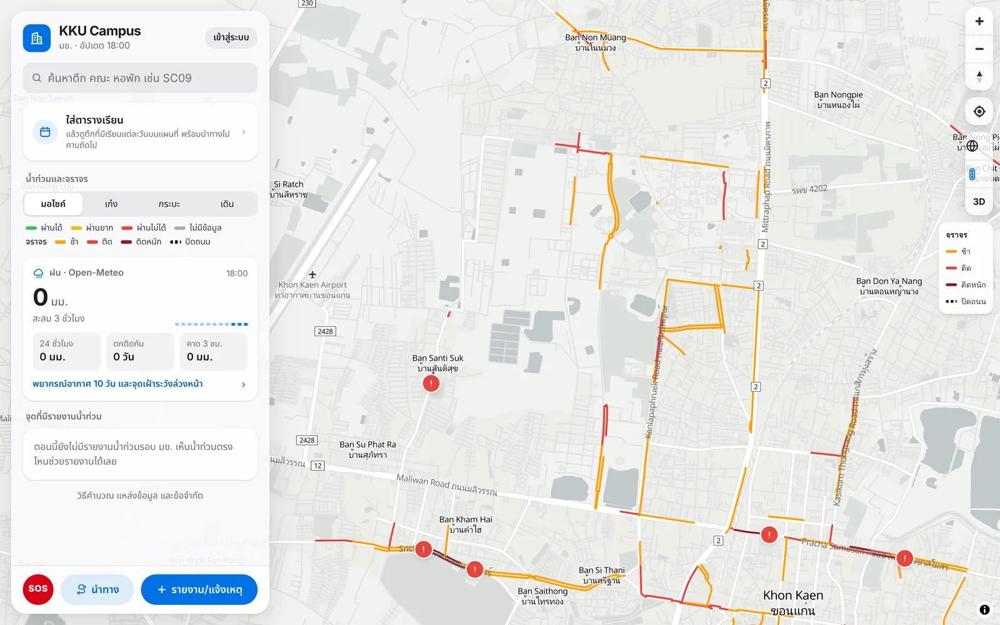
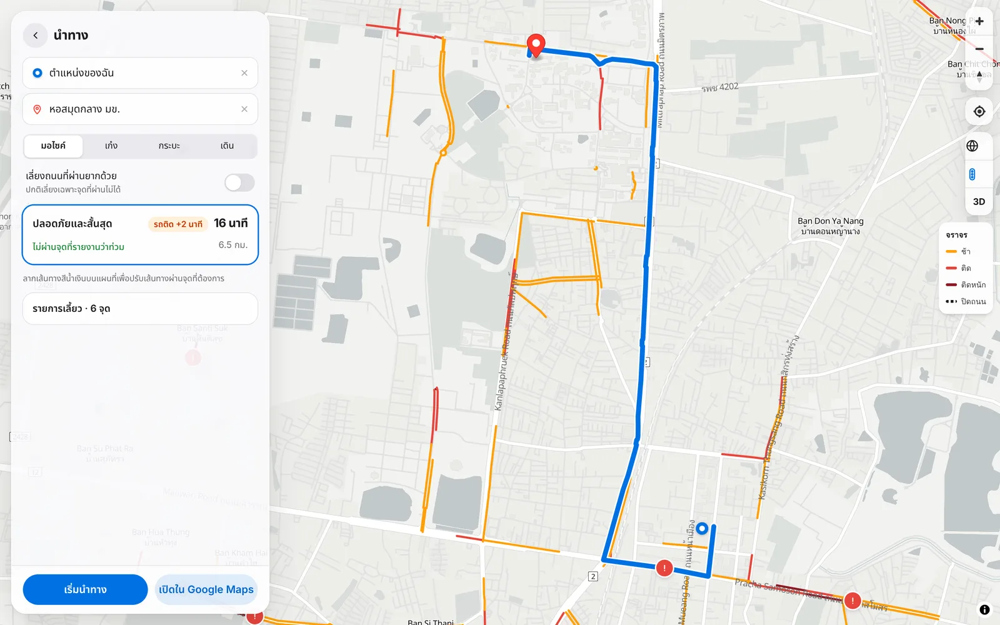
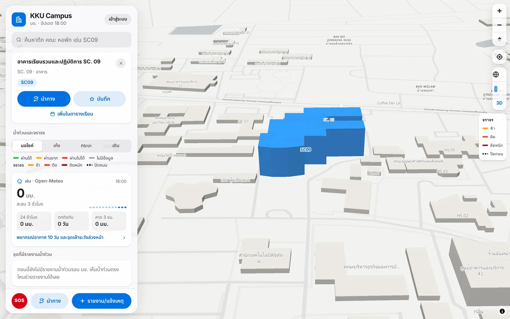
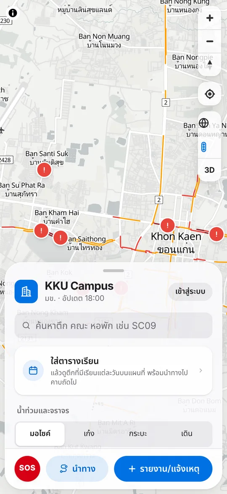
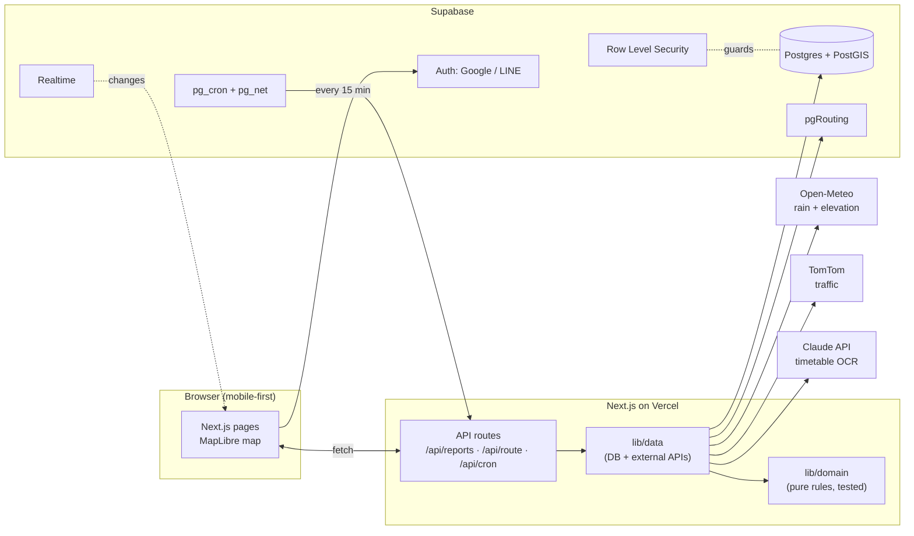
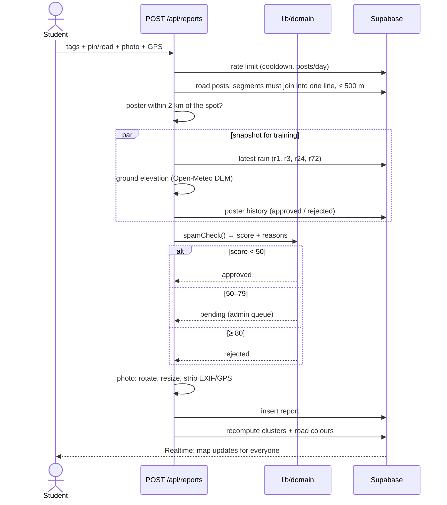
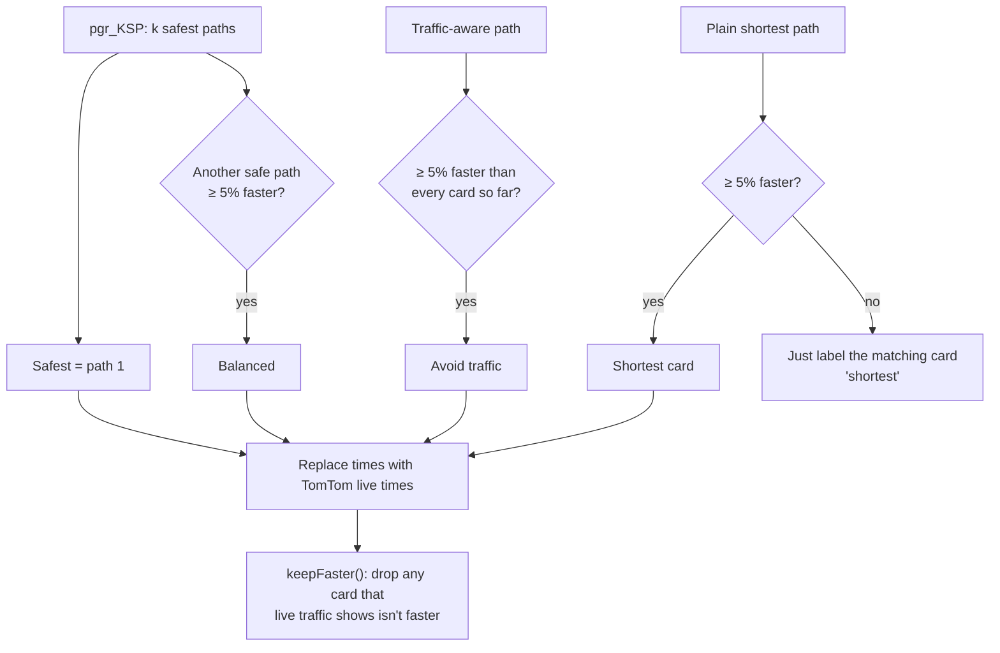

# KKU Campus: flood map, flood-avoiding navigation and a campus companion

[](https://github.com/naphatphong/kku_flood_watch/actions/workflows/ci.yml)
[](LICENSE)
[](https://kku-flood-watch.vercel.app)

**Live:** https://kku-flood-watch.vercel.app

> **สรุปภาษาไทย:** เว็บแอปฟูลสแตกสำหรับนักศึกษา มข. ที่รวมแผนที่น้ำท่วมจากรายงานของชุมชน
> นำทางเลี่ยงถนนที่น้ำท่วมและรถติด ค้นหาตึกแบบ 3 มิติ ตารางเรียน และพยากรณ์อากาศ
> จุดเด่นคือสูตรประเมินความเสี่ยงที่อธิบายได้ (ฝน + ความต่ำของพื้นที่ + รายงานจากผู้ใช้),
> ระบบหาเส้นทางที่คำนวณในฐานข้อมูลด้วย pgRouting และความปลอดภัยระดับแถวข้อมูล (RLS) ที่มีเทสต์รองรับ

Khon Kaen University floods during the rainy season, and students find out which roads are under water
by getting their feet wet. KKU Campus is a **full-stack, crowd-sourced flood map with routing that avoids
flooded roads**. It grew into a campus companion: 3D building search, a class timetable, traffic and weather.

`Next.js 16` · `TypeScript` · `Supabase (Postgres + PostGIS + pgRouting + RLS + Realtime + pg_cron)` ·
`MapLibre GL` · `Claude API (vision)` · `Open-Meteo` · `TomTom` · `Vercel`

| Flood and traffic map | Flood-avoiding navigation |
|---|---|
|  |  |
| **Building search with 3D highlight** | **Mobile** |
|  |  |

### Start here

| If you have… | Read |
|---|---|
| 2 minutes | [Highlights](#highlights) and the screenshots above |
| 10 minutes | [How I thought about it](#how-i-thought-about-it): the formula, routing and security model |
| More | [docs/PLAN.md](docs/PLAN.md) (every decision and why), then `lib/domain/` (the rules, with tests) |

---

## Highlights

| | |
|---|---|
| **Flood risk you can explain** | A rule-based score that combines live rain, low-lying ground and community posts. Every circle shows *why* it got its % |
| **Routing that avoids floods** | pgRouting inside Postgres; each road's cost depends on the vehicle (motorbike, car, pickup, walking) and the road's flood status. Shows up to 4 route cards: safest, balanced, avoid traffic, shortest |
| **Security in the database** | Row Level Security on every table, and SQL tests that log in as anon, user and admin to check it |
| **Spam defence** | An explainable spam score (account age, GPS distance, rain plausibility, links, history), rate limits, and photos stripped of EXIF/GPS |
| **Logic I can test** | Every formula is a pure function in `lib/domain/` with no DB access; **31 unit tests**, all passing |
| **AI where it helps** | Claude reads a screenshot of your registrar timetable and returns structured classes (JSON schema) |
| **Realtime + scheduled jobs** | Supabase Realtime pushes changes to open maps; pg_cron refreshes rain, clusters and traffic every 15 min |

---

## How I thought about it

### 1. Rules first, data later

I didn't have historical flood data, so I couldn't train a model. Rather than fake one, I made two decisions:

1. **Phase 1 uses explainable rules.** A student should be able to see *why* a zone shows 72%.
2. **Every post saves a snapshot** (rain at that moment, ground elevation, tags, votes), so later there's
   enough labelled data to train a model. That includes "dry, passable" posts, because a model needs
   negative examples too.

I wrote every decision down in [docs/PLAN.md](docs/PLAN.md) (§0 overrides
the rest), and every tunable number lives in one file: [`lib/config.ts`](lib/config.ts).

### 2. System architecture



**Layering rule:** `lib/domain/` only takes plain data and returns plain data. It never touches the
database. Because of that, the flood formula, spam check, route picking and turn list are all
unit-testable in under a second, and the import scripts reuse the same code.

### 3. Life of a flood report



### 4. The flood-risk formula

Instead of fixed zones, **posts cluster themselves** (DBSCAN, posts within 300 m chain together). Each
cluster then gets a score:

```
rain   = 0.5·min(1, R3/50) + 0.3·min(1, R24/90) + 0.2·min(1, rainyDays/5)
low    = 0.6 | 1.0 | 1.3    ← elevation tercile of the posts vs. the whole area (Copernicus DEM)
base   = min(100, rain · low · 100)                     ← what the weather alone says

weight = 0.5^(hours/2) · votes                          ← half-life 2 h; "still flooded" ×1.2, "receded" ×0.6
report = Σ(wᵢ·scoreᵢ) / Σwᵢ                             ← what people on the ground say

c      = min(0.8, 0.16 · Σw)                            ← confidence grows with evidence
final  = (1 − c) · base + c · report
```

Why this shape: with **no posts**, the map still warns from rain + terrain. As **more people post**,
the score trusts them more, but never 100% (c ≤ 0.8), so one troll can't paint the map red. Before anyone
posts, "watch circles" appear on low ground pockets when it rains.

### 5. Routing that avoids floods

The graph search runs **inside Postgres** (pgRouting), so there's no separate routing server:

```
cost(segment, vehicle) = length / speed
                         × 3        if the road is "hard to pass" for this vehicle
                         × 1.5      if inside a flood circle with final ≥ 60%
                         removed    if "blocked" for this vehicle (or "hard", if the user chooses)
one-way streets: no driving backwards; walking ignores them
```

Then `pickRoutes()` decides which cards to show:



Each card is there because it's genuinely a different trade-off. If two routes are really the same, the
user only sees one card.

### 6. Security model

- **Guests** can view the map and navigate. Posting, voting and flagging need a login (Google / LINE).
- **RLS on every table:** anyone can read approved reports. Owners see their own pending ones, and admins
  see everything. Users can change only their own `display_name`, enforced with a column-level `GRANT`.
- Report creation, moderation and the cron refresh run on the server with the service role, so clients
  get almost no write policies.
- `supabase/tests/policies.test.sql` switches roles (`set role anon` / `authenticated` + JWT claims) and
  asserts what each one can see and do.

---

## Features

- **Flood map:** clusters coloured by risk, road colours per vehicle (green / yellow / red / grey), posts with photos and votes
- **Navigate:** safest / balanced / avoid-traffic / shortest, Thai turn-by-turn list, warnings for incidents on the route, warning when a road ahead turns blocked, hand-off to Google Maps outside the area
- **Report:** area (pin + radius) or road (tap segments), water level and passability per vehicle; road incidents (accident, closure, road works) with a shorter expiry
- **Campus:** 3D building search (Thai, English, codes), saved places, class timetable with "next class", import from the registrar by paste (HTML colspan parsing) or screenshot (Claude vision)
- **Weather:** iOS-style hourly + 10-day forecast with alerts
- **Admin:** moderation queue, ban users, admin log
- **SOS button** with campus and national emergency numbers

## Project structure

| Folder | What it does |
|---|---|
| `lib/domain/` | Pure rules (no DB): rain, clustering, flood %, road colours, spam, route picking, turn list + `domain.test.ts` |
| `lib/data/` | Reads and writes data (Supabase, Open-Meteo, TomTom, Claude), plus demo mode |
| `lib/supabase/` | Supabase clients (user, anon, service role) |
| `app/` | Pages (`/`, `/navigate`, `/report`, `/post/[id]`, `/me`, `/admin`, `/timetable`, `/weather`, `/about`, `/login`) and API (`app/api/`) |
| `components/` | UI by page (`home`, `navigate`, `report`, `post`, `admin`, `timetable`) + shared (`ui`, `map`) |
| `supabase/migrations/` | Schema, RLS, SQL functions (pgRouting), Realtime, pg_cron |
| `supabase/tests/` | SQL tests for RLS, triggers and RPCs |
| `supabase/seed/roads.sql` | OSM roads around KKU (built with `scripts/import-roads.ts`) |
| `scripts/` | One-off data prep: OSM roads, footpaths, buildings, elevation terciles |

## Run it locally

```bash
npm install
cp .env.example .env.local   # optional: leave it empty to run in demo mode
npm run dev       # http://localhost:3000. Without Supabase it runs in demo mode (real rain, sample posts)
npm test          # 31 unit tests for lib/domain
npm run test:db   # migrations + RLS + SQL (needs Postgres with PostGIS and pgRouting)
```

CI runs the unit tests, the type check and the database tests on every push.

- **Connect Supabase, logins and scheduled jobs:** [docs/SETUP.md](docs/SETUP.md)
- **Update building names:** `NODE_USE_ENV_PROXY=1 npx tsx scripts/import-buildings.ts` (extra names: [`lib/building-aliases.ts`](lib/building-aliases.ts))
- **Plan and decision log:** [docs/PLAN.md](docs/PLAN.md)
- **Every tunable number:** [`lib/config.ts`](lib/config.ts)

Vercel deploys automatically on every push to `main`.

## How I built this

I defined the problem and made the design decisions: the flood-risk formula, clustering posts instead of
fixed zones, the routing costs, the spam rules and the security model. Each decision is written down with
its reasoning in [docs/PLAN.md](docs/PLAN.md). I used an AI coding assistant to speed up implementation,
and I reviewed, tested and can explain every part of the system.

> ผมเป็นคนกำหนดโจทย์และตัดสินใจเรื่องการออกแบบ (สูตรความเสี่ยง, การจับกลุ่มโพสต์, ต้นทุนเส้นทาง, กฎกันสแปม,
> ระบบความปลอดภัย) โดยบันทึกเหตุผลไว้ใน PLAN.md และใช้ AI ช่วยเขียนโค้ดให้เร็วขึ้น ทุกส่วนผมรีวิว ทดสอบ และอธิบายได้

## What I'd do next

- Move clustering to PostGIS `ST_ClusterDBSCAN` once posts reach the thousands (today it's O(n²) in TypeScript, which is fine for hundreds)
- Train a model on the saved snapshots once there's a season of labelled data
- E2E tests (Playwright) for the report → map → route flow

---

Map and road data © OpenStreetMap contributors · Rain and elevation: Open-Meteo · Traffic: TomTom ·
Code released under the [MIT License](LICENSE).
