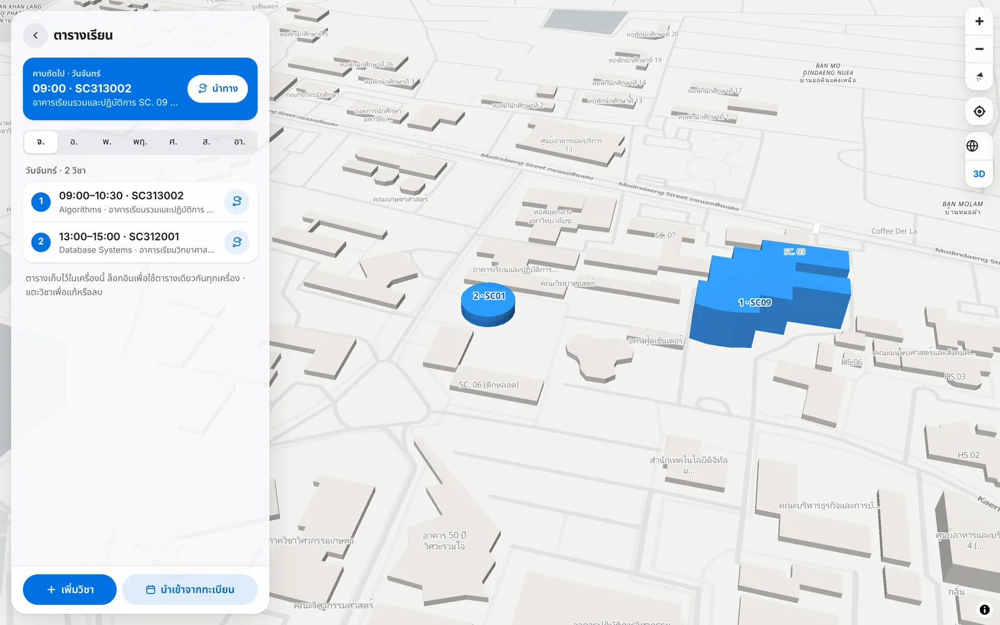
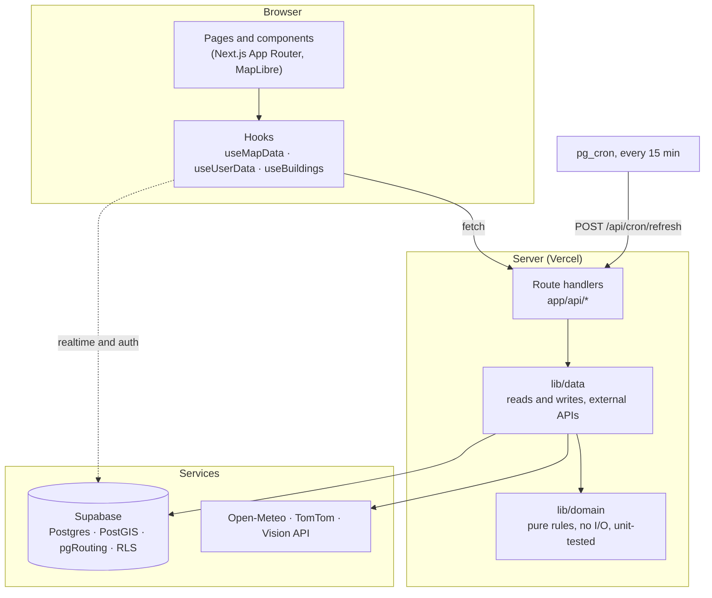
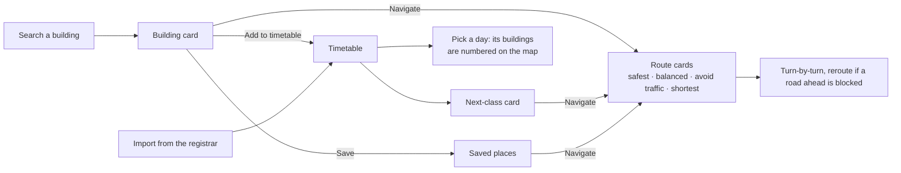

# KKU Campus: find buildings, plan your classes and get around Khon Kaen University

[](https://github.com/naphatphong/kku_flood_watch/actions/workflows/ci.yml)
[](LICENSE)
[](https://kku-flood-watch.vercel.app)

**Live:** https://kku-flood-watch.vercel.app

> เว็บแอปสำหรับนักศึกษา มข. รวมทุกอย่างที่ใช้ในมหาวิทยาลัยไว้ที่เดียว
> ค้นหาตึกเรียนแบบ 3 มิติ (พิมพ์ SC9 หรือ "วิศวะ" ก็เจอ), ใส่ตารางเรียนแล้วดูตึกที่ต้องไปในแต่ละวันบนแผนที่
> (นำเข้าจากระบบทะเบียนได้), นำทางด้วยรถหรือเดินเท้าโดยเลี่ยงรถติดและถนนน้ำท่วม,
> ดูแผนที่น้ำท่วมจากรายงานของชุมชน, พยากรณ์อากาศ 10 วัน และปุ่ม SOS เบอร์ฉุกเฉิน

KKU Campus is a **campus companion for students**: look up any building, put your class timetable on the
map, get walking or driving directions that avoid traffic and flooded roads, and see what the weather and
roads are doing before you leave. It is a full-stack web app with a real database, logins, an admin panel
and scheduled jobs, deployed on Vercel.

`Next.js 16` · `TypeScript` · `Supabase (Postgres + PostGIS + pgRouting + RLS + Realtime + pg_cron)` ·
`MapLibre GL` · `Claude API (vision)` · `Open-Meteo` · `TomTom` · `Vercel`

## What you can do

| Find a building | Plan your classes |
|---|---|
|  |  |
| Search in Thai, English or by code (`SC9` = `SC09`, "วิศวะ" finds "วิศวกรรม"). The building lights up in 3D, with navigate, save and add-to-timetable | Add classes by hand or import them from the registrar. Each day's buildings are numbered on the map, with a "next class" card and a navigate button |

| Get there | Know the conditions |
|---|---|
|  |  |
| Drive, ride or walk. Walking uses the campus footpaths. Routes avoid roads reported flooded and show live traffic delay | Flood circles from community reports, live traffic, 10-day weather and an SOS button with campus and national emergency numbers |

<p align="center"><br><sub>Phone layout: the same app as a bottom sheet over the map</sub></p>

### Start here

| If you have… | Read |
|---|---|
| 2 minutes | The screenshots above and [Highlights](#highlights) |
| 10 minutes | [docs/ARCHITECTURE.md](docs/ARCHITECTURE.md): how the campus features and the flood-risk formula work, with diagrams |
| More | [docs/PLAN.md](docs/PLAN.md) (every decision and why), then `lib/domain/` (the rules, with tests) |

---

## Features

**Campus**
- 184 named buildings and places from OpenStreetMap, with codes normalised (`SC. 09` → `SC09`) and extra nicknames in one file
- Search, then a 3D highlight of the exact building; names appear from zoom 15 and the one under the mouse turns blue; tapping picks the block under your finger, even on a tilted map
- Saved places, kept on your device and synced to your account when you sign in

**Classes**
- Timetable by day: add, edit and delete classes, pick the building by search or by tapping the map
- Import from the registrar (reg.kku.ac.th) by pasting the copied table, or by uploading a screenshot that a vision model reads; every row is reviewed before it is saved
- Building codes the app doesn't know are placed once by a signed-in user and shared with everyone

**Getting around**
- Routes for motorbike, car, pickup and walking: safest, balanced, avoid-traffic and shortest cards, with Thai turn-by-turn directions
- Live traffic delay per route, warnings for incidents on the way, a prompt to reroute when a road ahead becomes blocked, and a Google Maps hand-off outside the area
- Drag the route on the map to add via points

**Safety and conditions**
- Flood map built from community posts (area or road), with photos, votes, spam checks and an admin review queue
- Road incident reports (accident, closure, road works) that expire after a short time
- Watch circles on low ground when rain is forecast, even before anyone posts
- iOS-style hourly and 10-day forecast with warnings; SOS button with campus security, the hospital and national hotlines

## Highlights

| | |
|---|---|
| **Search that understands how people type** | Normalises Thai/English, codes with or without zeros and common nicknames: `lib/domain/buildings.ts` |
| **Timetable logic you can test** | Bangkok-time clock, "next class" across days, validation, registrar table parsing from HTML `colspan`: `lib/domain/timetable.ts`, `reg-import.ts` |
| **Routing inside the database** | pgRouting costs per vehicle and per road status, walking over footpaths, traffic-aware time: `supabase/migrations/` |
| **Flood risk you can explain** | A rule-based score from live rain, low ground and community posts; each circle shows why it got its percentage |
| **Security in the database** | Row Level Security on every table and SQL tests that log in as anon, user and admin |
| **Pure logic, tested, in CI** | Rules are pure functions with 31 unit tests plus SQL tests, run on every push |

## Project structure

| Folder | What it does |
|---|---|
| `lib/domain/` | Pure rules (no DB): building search, timetable, registrar import, rain, clustering, flood %, road colours, spam, route picking, turn list + `domain.test.ts` |
| `lib/data/` | Reads and writes data (Supabase, Open-Meteo, TomTom, Claude), plus demo mode |
| `lib/supabase/` | Supabase clients (user, anon, service role) |
| `app/` | Pages (`/`, `/navigate`, `/timetable`, `/report`, `/weather`, `/post/[id]`, `/me`, `/admin`, `/about`, `/login`) and API (`app/api/`) |
| `components/` | UI by page (`home`, `navigate`, `timetable`, `report`, `post`, `admin`) + shared (`ui`, `map`) |
| `supabase/migrations/` | Schema, RLS, SQL functions (pgRouting), Realtime, pg_cron |
| `supabase/tests/` | SQL tests for RLS, triggers and RPCs |
| `scripts/` | One-off data prep: OSM roads, footpaths, buildings, elevation terciles |

## Run it locally

```bash
npm install
cp .env.example .env.local   # optional: leave it empty to run in demo mode
npm run dev       # http://localhost:3000. Without Supabase it runs in demo mode (real rain, sample posts)
npm test          # 31 unit tests for lib/domain
npm run test:db   # migrations + RLS + SQL (needs Postgres with PostGIS and pgRouting)
```

CI runs the unit tests, the type check and the database tests on every push.

- **Connect Supabase, logins and scheduled jobs:** [docs/SETUP.md](docs/SETUP.md)
- **Update building names:** `NODE_USE_ENV_PROXY=1 npx tsx scripts/import-buildings.ts` (extra names: [`lib/building-aliases.ts`](lib/building-aliases.ts))
- **Plan and decision log:** [docs/PLAN.md](docs/PLAN.md)
- **Every tunable number:** [`lib/config.ts`](lib/config.ts)

Vercel deploys automatically on every push to `main`.

## Structure, flow and logic

### How the code is layered

Each layer only talks to the one below it, and the bottom layer never touches I/O. That is why the rules can be
tested in under a second and reused by the data-prep scripts.



### A student's flow through the app



### The logic, in one place

| Logic | How it decides | Code |
|---|---|---|
| **Building search** | Normalise text (case, spaces, leading zeros, Thai "ะ"), every word must match; exact code 100, prefix 40, contains 20, teaching places win ties | `lib/domain/buildings.ts` |
| **Next class** | For today and the next 6 days (Bangkok time), take the first class that has not ended; "minutes until" goes negative while it runs | `lib/domain/timetable.ts` |
| **Registrar import** | Pasted table: each cell's `colspan` gives start and end. Screenshot: schema-checked output, validated, reviewed by the user | `lib/domain/reg-import.ts` |
| **Route cards** | Safest first; add balanced, avoid-traffic and shortest only when each is at least 5% faster than every card before it; live traffic times may drop a card | `lib/domain/route.ts` |
| **Road cost** | `length / speed`, x3 if hard to pass, x1.5 inside a circle at 60%+, removed if blocked, no driving against one-way streets | `supabase/migrations/*routing*` |
| **Flood risk** | `final = (1 - c) * base + c * report`, with `c = min(0.8, 0.16 * sum of post weights)` | `lib/domain/cluster.ts` |
| **Post weight** | Halves every 2 hours, expires after 6 hours; "still flooded" x1.2 (max x2), "receded" x0.6 | `lib/domain/post.ts` |
| **Spam score** | Under 50 approved, 50 to 79 pending for review, 80 and above rejected | `lib/domain/spam.ts` |

The full reasoning, with diagrams for the report lifecycle, the formula and routing, is in
[docs/ARCHITECTURE.md](docs/ARCHITECTURE.md).

## How I built this

I own this codebase end to end: the product decisions, the architecture, the data model and every code
review. All the logic (building search, the timetable rules, the routing costs, the flood-risk formula,
the spam rules and the security model) is designed by me and written down with its reasoning in
[docs/PLAN.md](docs/PLAN.md). I can walk through any file and explain why it works the way it does.

**Engineering skills this repo shows, and where to look:**

| Skill | In this project |
|---|---|
| **TypeScript + React (Next.js App Router)** | Server/client split, route handlers in `app/api/`, custom hooks in `lib/hooks/`, a small UI kit in `components/ui/` |
| **Maps and 3D** | MapLibre layers, building extrusions highlighted by feature state, picking the right building under a tilted camera: `components/map/` |
| **Algorithms as pure functions** | Search ranking, "next class", DBSCAN clustering, risk scoring with time decay, route-card selection, turn-by-turn text from bearings: `lib/domain/` |
| **SQL and GIS** | PostGIS spatial joins, pgRouting cost functions with per-vehicle rules, RPCs and triggers: `supabase/migrations/` |
| **Security** | Row Level Security on every table plus column-level grants, tested by switching roles in `supabase/tests/` |
| **Testing and CI** | 31 unit tests and SQL tests, run on every push by GitHub Actions |
| **Debugging real bugs** | Realtime channel reuse crash, a Chromium effect-cleanup crash, WebGL context loss, picking merged map tiles: each root cause is explained in its commit |
| **Integrating services** | Supabase Auth (Google, LINE), Open-Meteo, TomTom, a vision API for timetable screenshots, pg_cron jobs |

I use an AI coding assistant as a tool to move faster. The design, the decisions and the responsibility for
the code are mine.

> ผมดูแลโปรเจกต์นี้ทั้งหมดตั้งแต่ตัดสินใจเรื่องผลิตภัณฑ์ สถาปัตยกรรม โครงสร้างข้อมูล จนถึงรีวิวโค้ดทุกส่วน
> โลจิกทั้งหมด (ค้นหาตึก, ตารางเรียน, ต้นทุนเส้นทาง, สูตรความเสี่ยงน้ำท่วม, กฎกันสแปม, ระบบความปลอดภัย)
> และบันทึกเหตุผลไว้ใน PLAN.md ใช้ AI เป็นเครื่องมือช่วยให้ทำงานเร็วขึ้น

## What I'd do next

- E2E tests (Playwright) for the search → timetable → navigate flow and for reporting a flood
- Move clustering to PostGIS `ST_ClusterDBSCAN` once posts reach the thousands (today it's O(n²) in TypeScript, which is fine for hundreds)
- Train a flood model on the saved snapshots once there's a season of labelled data

---

Map, road and building data © OpenStreetMap contributors · Rain and elevation: Open-Meteo · Traffic: TomTom ·
Code released under the [MIT License](LICENSE).
