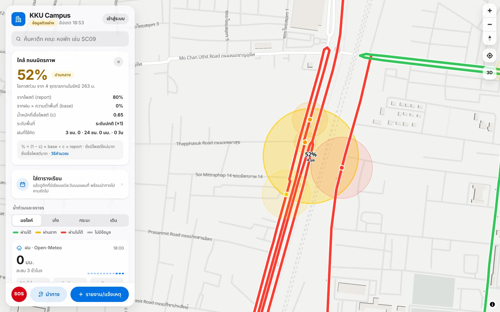

# KKU Campus: flood map, flood-avoiding navigation and a campus companion

[](https://github.com/naphatphong/kku_flood_watch/actions/workflows/ci.yml)
[](LICENSE)
[](https://kku-flood-watch.vercel.app)

**Live:** https://kku-flood-watch.vercel.app

> เว็บแอปสำหรับนักศึกษา มข. ที่รวมแผนที่น้ำท่วมจากรายงานของชุมชน
> นำทางเลี่ยงถนนที่น้ำท่วมและรถติด ค้นหาตึกแบบ 3 มิติ ตารางเรียน และพยากรณ์อากาศ
> จุดเด่นคือสูตรประเมินความเสี่ยงที่อธิบายได้ (ฝน + ความต่ำของพื้นที่ + รายงานจากผู้ใช้),
> ระบบหาเส้นทางที่คำนวณในฐานข้อมูลด้วย pgRouting และความปลอดภัยระดับแถวข้อมูล (RLS) ที่มีเทสต์รองรับ

Khon Kaen University floods during the rainy season, and students find out which roads are under water
by getting their feet wet. KKU Campus is a **full-stack, crowd-sourced flood map with routing that avoids
flooded roads**. It grew into a campus companion: 3D building search, a class timetable, traffic and weather.

`Next.js 16` · `TypeScript` · `Supabase (Postgres + PostGIS + pgRouting + RLS + Realtime + pg_cron)` ·
`MapLibre GL` · `Claude API (vision)` · `Open-Meteo` · `TomTom` · `Vercel`

| Flood and traffic map (live) | Flood-avoiding navigation |
|---|---|
|  |  |
| **Building search with 3D highlight** | **Why a circle shows 52%** (demo mode, sample data) |
|  |  |

<p align="center"><br><sub>Mobile layout</sub></p>

### Start here

| If you have… | Read |
|---|---|
| 2 minutes | [Highlights](#highlights) and the screenshots above |
| 10 minutes | [docs/ARCHITECTURE.md](docs/ARCHITECTURE.md): the formula, routing, security model and diagrams |
| More | [docs/PLAN.md](docs/PLAN.md) (every decision and why), then `lib/domain/` (the rules, with tests) |

---

## Highlights

| | |
|---|---|
| **Flood risk you can explain** | A rule-based score that combines live rain, low-lying ground and community posts. Every circle shows *why* it got its % |
| **Routing that avoids floods** | pgRouting inside Postgres; each road's cost depends on the vehicle (motorbike, car, pickup, walking) and the road's flood status. Shows up to 4 route cards: safest, balanced, avoid traffic, shortest |
| **Security in the database** | Row Level Security on every table, and SQL tests that log in as anon, user and admin to check it |
| **Spam defence** | An explainable spam score (account age, GPS distance, rain plausibility, links, history), rate limits, and photos stripped of EXIF/GPS |
| **Logic I can test** | Every formula is a pure function in `lib/domain/` with no DB access; **31 unit tests**, all passing |
| **AI where it helps** | Claude reads a screenshot of your registrar timetable and returns structured classes (JSON schema) |
| **Realtime + scheduled jobs** | Supabase Realtime pushes changes to open maps; pg_cron refreshes rain, clusters and traffic every 15 min |

---


## Features

- **Flood map:** clusters coloured by risk, road colours per vehicle (green / yellow / red / grey), posts with photos and votes
- **Navigate:** safest / balanced / avoid-traffic / shortest, Thai turn-by-turn list, warnings for incidents on the route, warning when a road ahead turns blocked, hand-off to Google Maps outside the area
- **Report:** area (pin + radius) or road (tap segments), water level and passability per vehicle; road incidents (accident, closure, road works) with a shorter expiry
- **Campus:** 3D building search (Thai, English, codes), saved places, class timetable with "next class", import from the registrar by paste (HTML colspan parsing) or screenshot (Claude vision)
- **Weather:** iOS-style hourly + 10-day forecast with alerts
- **Admin:** moderation queue, ban users, admin log
- **SOS button** with campus and national emergency numbers

## Project structure

| Folder | What it does |
|---|---|
| `lib/domain/` | Pure rules (no DB): rain, clustering, flood %, road colours, spam, route picking, turn list + `domain.test.ts` |
| `lib/data/` | Reads and writes data (Supabase, Open-Meteo, TomTom, Claude), plus demo mode |
| `lib/supabase/` | Supabase clients (user, anon, service role) |
| `app/` | Pages (`/`, `/navigate`, `/report`, `/post/[id]`, `/me`, `/admin`, `/timetable`, `/weather`, `/about`, `/login`) and API (`app/api/`) |
| `components/` | UI by page (`home`, `navigate`, `report`, `post`, `admin`, `timetable`) + shared (`ui`, `map`) |
| `supabase/migrations/` | Schema, RLS, SQL functions (pgRouting), Realtime, pg_cron |
| `supabase/tests/` | SQL tests for RLS, triggers and RPCs |
| `supabase/seed/roads.sql` | OSM roads around KKU (built with `scripts/import-roads.ts`) |
| `scripts/` | One-off data prep: OSM roads, footpaths, buildings, elevation terciles |

## Run it locally

```bash
npm install
cp .env.example .env.local   # optional: leave it empty to run in demo mode
npm run dev       # http://localhost:3000. Without Supabase it runs in demo mode (real rain, sample posts)
npm test          # 31 unit tests for lib/domain
npm run test:db   # migrations + RLS + SQL (needs Postgres with PostGIS and pgRouting)
```

CI runs the unit tests, the type check and the database tests on every push.

- **Connect Supabase, logins and scheduled jobs:** [docs/SETUP.md](docs/SETUP.md)
- **Update building names:** `NODE_USE_ENV_PROXY=1 npx tsx scripts/import-buildings.ts` (extra names: [`lib/building-aliases.ts`](lib/building-aliases.ts))
- **Plan and decision log:** [docs/PLAN.md](docs/PLAN.md)
- **Every tunable number:** [`lib/config.ts`](lib/config.ts)

Vercel deploys automatically on every push to `main`.

## How I built this

I own this codebase end to end: the product decisions, the architecture, the data model and every code
review. All the logic (the flood-risk formula, clustering posts instead of fixed zones, the routing costs,
the spam rules and the security model) is designed by me and written down with its reasoning in
[docs/PLAN.md](docs/PLAN.md). I can walk through any file and explain why it works the way it does.

**Engineering skills this repo shows, and where to look:**

| Skill | In this project |
|---|---|
| **TypeScript + React (Next.js App Router)** | Server/client split, route handlers in `app/api/`, custom hooks in `lib/hooks/`, a small UI kit in `components/ui/` |
| **Algorithms as pure functions** | DBSCAN clustering, risk scoring with time decay, route-card selection, turn-by-turn text from bearings: `lib/domain/` |
| **SQL and GIS** | PostGIS spatial joins, pgRouting cost functions with per-vehicle rules, RPCs and triggers: `supabase/migrations/` |
| **Security** | Row Level Security on every table plus column-level grants, tested by switching roles in `supabase/tests/` |
| **Testing and CI** | 31 unit tests and SQL tests, run on every push by GitHub Actions |
| **Debugging real bugs** | Realtime channel reuse crash, a Chromium effect-cleanup crash, WebGL context loss: each root cause is explained in its commit |
| **Integrating services** | Supabase Auth (Google, LINE), Open-Meteo, TomTom, a vision API for timetable screenshots, pg_cron jobs |

I use an AI coding assistant as a tool to move faster. The design, the decisions and the responsibility for
the code are mine.

> ผมดูแลโปรเจกต์นี้ทั้งหมดตั้งแต่ตัดสินใจเรื่องผลิตภัณฑ์ สถาปัตยกรรม โครงสร้างข้อมูล จนถึงรีวิวโค้ดทุกส่วน
> โลจิกทั้งหมด (สูตรความเสี่ยง, การจับกลุ่มโพสต์, ต้นทุนเส้นทาง, กฎกันสแปม, ระบบความปลอดภัย) ผมออกแบบเอง
> และบันทึกเหตุผลไว้ใน PLAN.md อธิบายได้ทุกไฟล์ ใช้ AI เป็นเครื่องมือช่วยให้ทำงานเร็วขึ้น

## What I'd do next

- Move clustering to PostGIS `ST_ClusterDBSCAN` once posts reach the thousands (today it's O(n²) in TypeScript, which is fine for hundreds)
- Train a model on the saved snapshots once there's a season of labelled data
- E2E tests (Playwright) for the report → map → route flow

---

Map and road data © OpenStreetMap contributors · Rain and elevation: Open-Meteo · Traffic: TomTom ·
Code released under the [MIT License](LICENSE).
