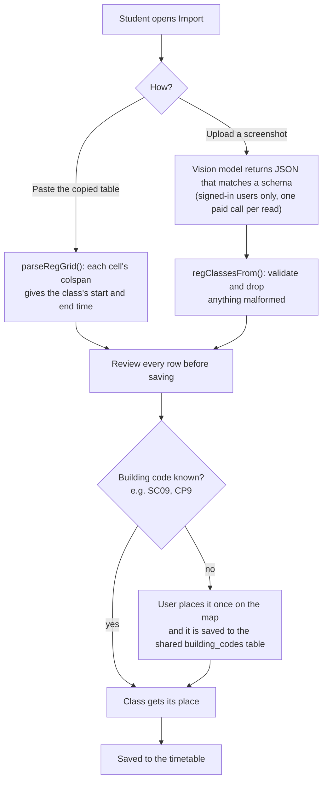
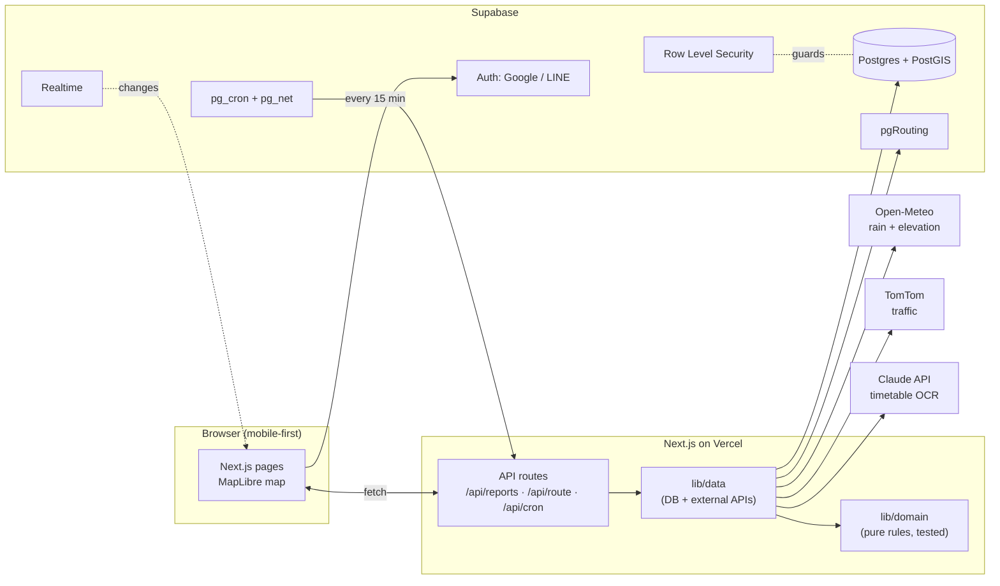
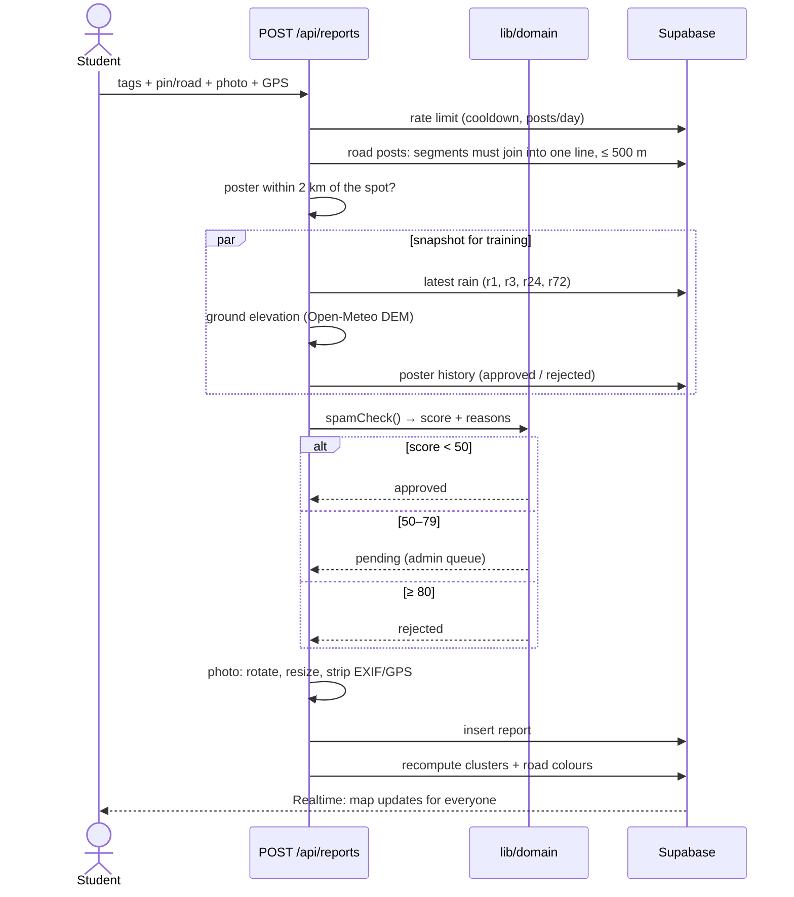
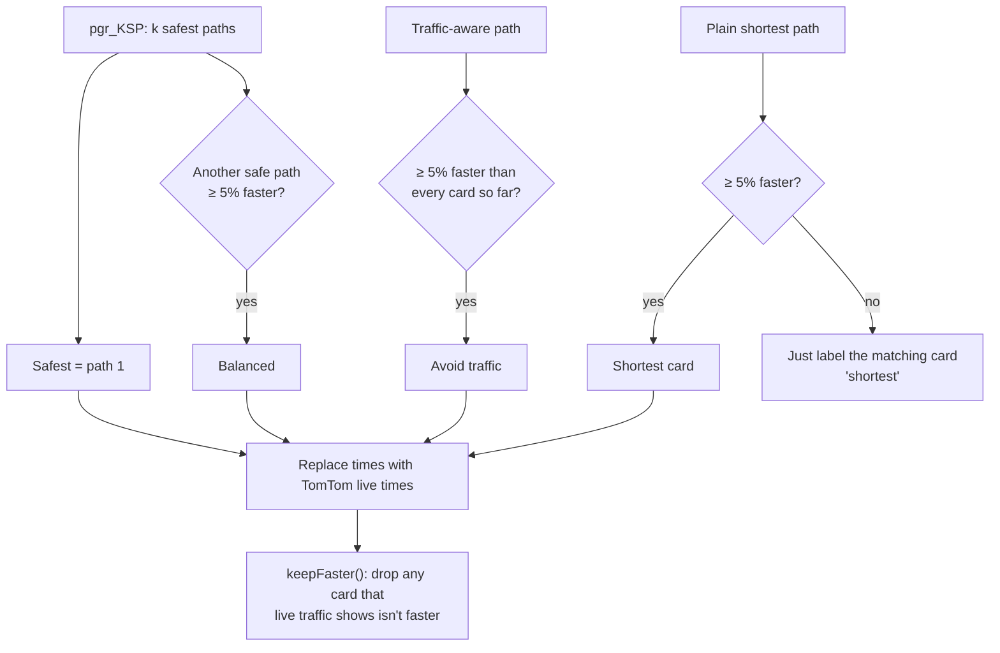

# Architecture and design decisions

How KKU Campus works and why it was designed this way. The overview, screenshots and setup are in the
[README](../README.md); every decision with its reasoning is in [PLAN.md](PLAN.md).

- [Part 1: Campus features](#part-1-campus-features): building search, the 3D highlight, the timetable and registrar import
- [Part 2: Flood risk, routing and security](#part-2-flood-risk-routing-and-security)

## Part 1: Campus features

### A. Finding a building

The building list is data, not code: `scripts/import-buildings.ts` reads named buildings and places from
OpenStreetMap and writes `public/data/kku-buildings.json` (184 places). Codes written as `SC. 09`, `sc-9`
or `SC 9` all become `SC09`, and nicknames live in one file, `lib/building-aliases.ts`.

Search (`lib/domain/buildings.ts`) is a pure function, so it is unit-tested on its own:

1. Normalise both sides: lower case, no spaces or punctuation, no leading zeros (`sc09` = `sc9`) and no
   Thai "ะ", so `วิศวะ` finds `วิศวกรรม`. The words ตึก and อาคาร are ignored because people use either.
2. Every word in the query must match something, otherwise the place is dropped.
3. Score each word: exact code 100, name starts with it 40, name contains it 20. Teaching buildings and
   faculties get a small bonus so they come first on ties.

### B. Highlighting the right building in 3D

The base map draws every building as a 3D block, but its tiles merge buildings of equal height into one
feature, so one id can cover up to 256 buildings. That caused two real bugs: hovering lit a whole group,
and a tap could resolve to a neighbour. The fix has two parts:

- A building that has no tile feature of its own is drawn as our own blue block (its outline grown 3%, as
  tall as the grey block under it), so exactly one building lights up.
- A tap is resolved by walking from the ground point back toward the camera up to roof height and taking the
  first outline the view ray meets, so tilted views select what the user is actually touching.

### C. The timetable

Timetable rules are pure functions in `lib/domain/timetable.ts`: validation, the day list, and `nextClass`
(the class going on now or the first one on a following day). All of it runs on Bangkok time (UTC+7, no
daylight saving) and never on the server's or the browser's local clock, which would give a different
"today" for a visitor abroad.

Saved places and the timetable are kept in `localStorage` and, when you sign in, in one `user_data` row
protected by an own-row RLS policy. The two copies merge by edit time and the newer one wins, so the app is
fully usable without an account.

### D. Importing from the registrar



Two choices worth noting: the model's output is treated as untrusted input (schema-checked, then validated
again, then reviewed by the user), and a code is learned once and shared, so the second student who has
`CP9` in their timetable needs no manual step. Admins can delete a wrong mapping.

## Part 2: Flood risk, routing and security

### 1. Rules first, data later

I didn't have historical flood data, so I couldn't train a model. Rather than fake one, I made two decisions:

1. **Phase 1 uses explainable rules.** A student should be able to see *why* a zone shows 72%.
2. **Every post saves a snapshot** (rain at that moment, ground elevation, tags, votes), so later there's
   enough labelled data to train a model. That includes "dry, passable" posts, because a model needs
   negative examples too.

I wrote every decision down in [PLAN.md](PLAN.md) (§0 overrides
the rest), and every tunable number lives in one file: [`lib/config.ts`](../lib/config.ts).

### 2. System architecture



**Layering rule:** `lib/domain/` only takes plain data and returns plain data. It never touches the
database. Because of that, the flood formula, spam check, route picking and turn list are all
unit-testable in under a second, and the import scripts reuse the same code.

### 3. Life of a flood report



### 4. The flood-risk formula

Instead of fixed zones, **posts cluster themselves** (DBSCAN, posts within 300 m chain together). Each
cluster then gets a score:

```
rain   = 0.5·min(1, R3/50) + 0.3·min(1, R24/90) + 0.2·min(1, rainyDays/5)
low    = 0.6 | 1.0 | 1.3    ← elevation tercile of the posts vs. the whole area (Copernicus DEM)
base   = min(100, rain · low · 100)                     ← what the weather alone says

weight = 0.5^(hours/2) · votes                          ← half-life 2 h; "still flooded" ×1.2, "receded" ×0.6
report = Σ(wᵢ·scoreᵢ) / Σwᵢ                             ← what people on the ground say

c      = min(0.8, 0.16 · Σw)                            ← confidence grows with evidence
final  = (1 − c) · base + c · report
```

Why this shape: with **no posts**, the map still warns from rain + terrain. As **more people post**,
the score trusts them more, but never 100% (c ≤ 0.8), so one troll can't paint the map red. Before anyone
posts, "watch circles" appear on low ground pockets when it rains.

### 5. Routing that avoids floods

The graph search runs **inside Postgres** (pgRouting), so there's no separate routing server:

```
cost(segment, vehicle) = length / speed
                         × 3        if the road is "hard to pass" for this vehicle
                         × 1.5      if inside a flood circle with final ≥ 60%
                         removed    if "blocked" for this vehicle (or "hard", if the user chooses)
one-way streets: no driving backwards; walking ignores them
```

Then `pickRoutes()` decides which cards to show:



Each card is there because it's genuinely a different trade-off. If two routes are really the same, the
user only sees one card.

### 6. Security model

- **Guests** can view the map and navigate. Posting, voting and flagging need a login (Google / LINE).
- **RLS on every table:** anyone can read approved reports. Owners see their own pending ones, and admins
  see everything. Users can change only their own `display_name`, enforced with a column-level `GRANT`.
- Report creation, moderation and the cron refresh run on the server with the service role, so clients
  get almost no write policies.
- `supabase/tests/policies.test.sql` switches roles (`set role anon` / `authenticated` + JWT claims) and
  asserts what each one can see and do.
